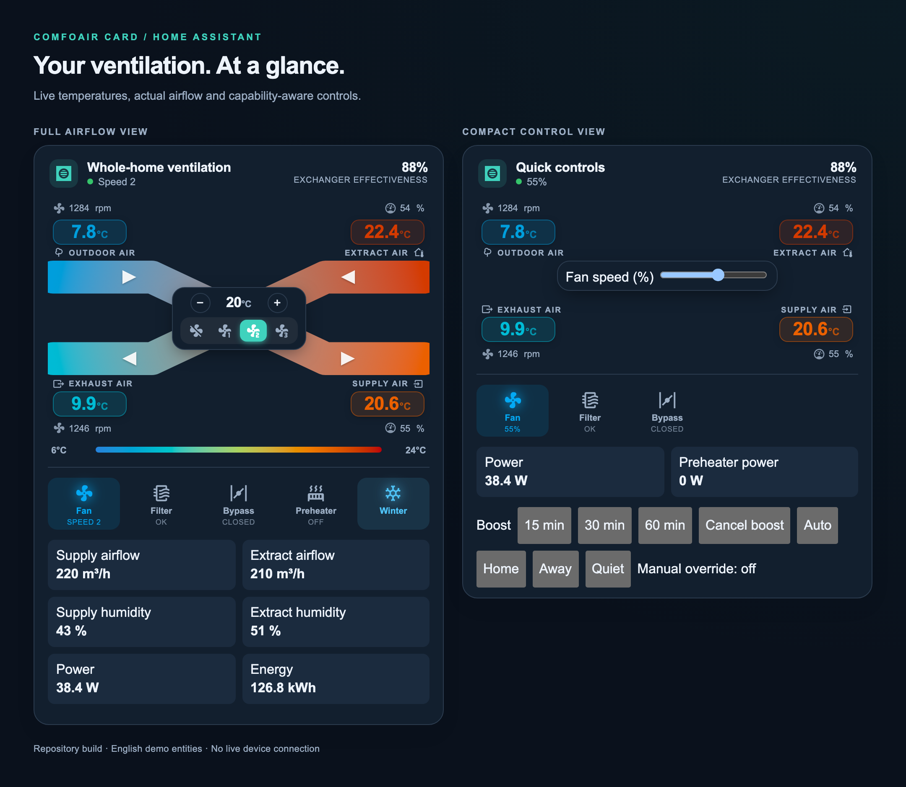
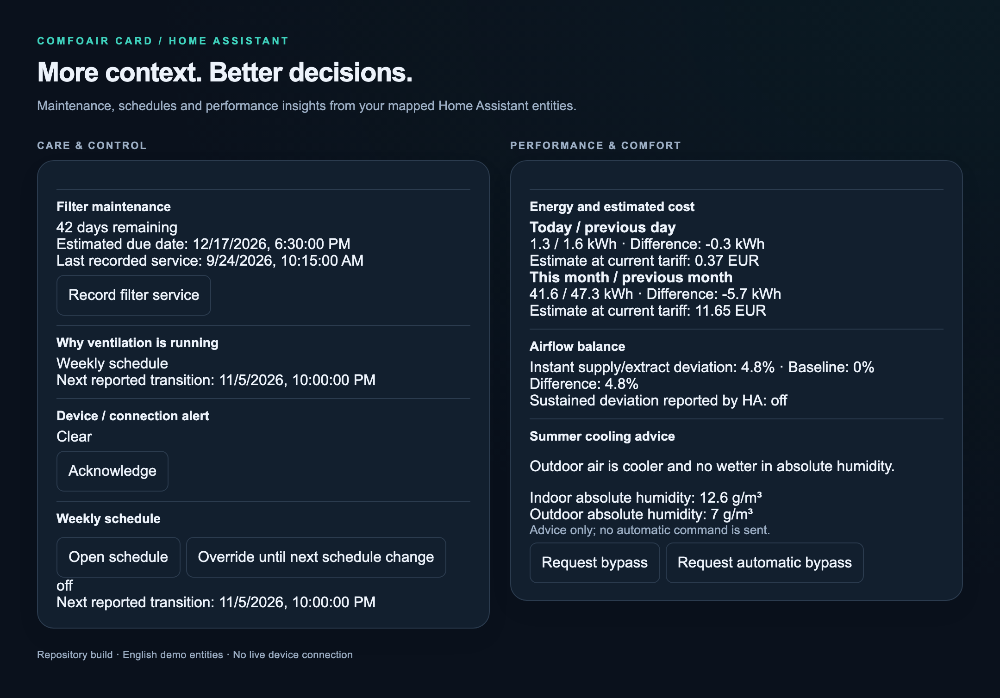
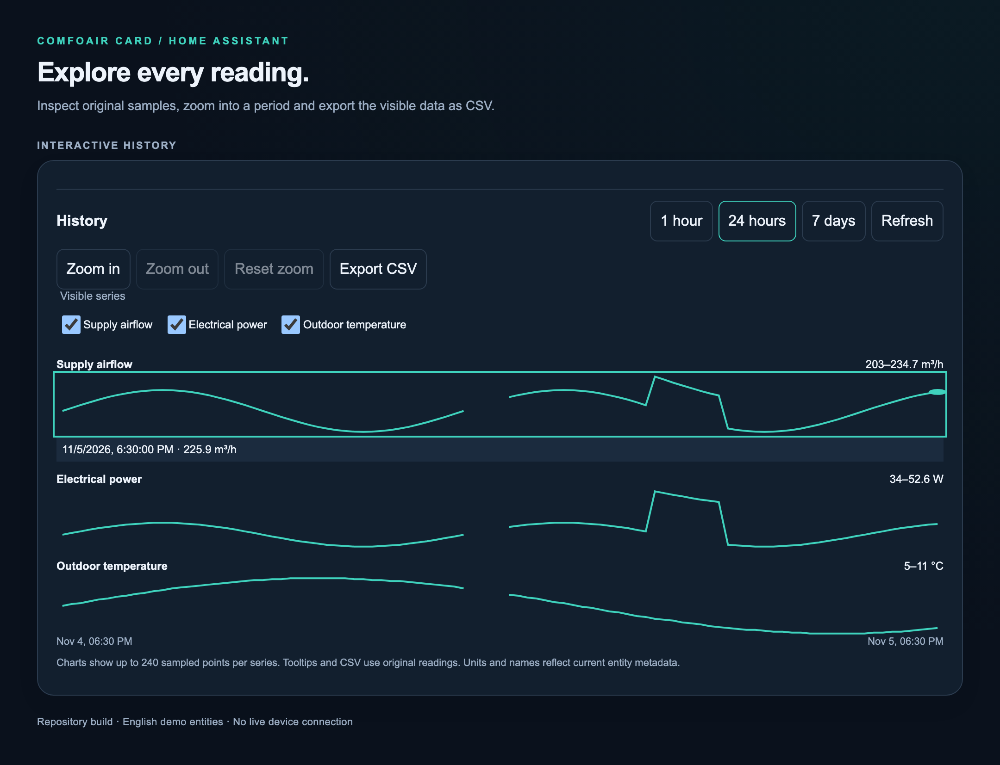

<h1 align="center">ComfoAir Card</h1>

<p align="center">
  <strong>A complete ventilation dashboard for Home Assistant.</strong><br>
  Live airflow, native controls, useful insights, and optional persistent automations.<br>
  Built for compatible ComfoAir, AERISnext, MQTT, and ESPHome installations.
</p>

<p align="center">
  <a href="https://github.com/wmaciejak/lovelace-comfoair/releases"></a>
  <a href="https://github.com/wmaciejak/lovelace-comfoair/actions/workflows/ci.yml"></a>
  <a href="hacs.json"></a>
  <a href="LICENSE"></a>
</p>

<p align="center">
  <a href="#installation">Install</a> ·
  <a href="#features">Features</a> ·
  <a href="#configuration-examples">Examples</a> ·
  <a href="docs/configuration.md">Configuration reference</a> ·
  <a href="#documentation">Guides</a> ·
  <a href="#troubleshooting">Troubleshooting</a>
</p>

<p align="center">
  <picture>
    <source media="(prefers-color-scheme: dark)" srcset="docs/images/overview-dark.png">
    <source media="(prefers-color-scheme: light)" srcset="docs/images/overview-light.png">
    
  </picture>
</p>

<p align="center"><sub>Current repository build with English demo entities. Theme colors come from the screenshot host. No live device connection.</sub></p>

ComfoAir Card brings your ventilation measurements and controls into one Lovelace card. Start with a `climate`, `fan`, or speed `select` entity. Add the sensors and actions that your integration provides. Use the full airflow view or a compact layout for smaller dashboards.

The card works through existing Home Assistant entities. Device support depends on your gateway and firmware. Optional backend packages provide timers, schedules, alerts, and demand control in Home Assistant.

## Features

| Area | Included capabilities |
| --- | --- |
| **Airflow at a glance** | Four temperature points, fan RPM, fan duty, color-coded air paths, optional animation, and a temperature legend. |
| **Native device controls** | Climate fan modes and supported setpoints, native fan percentages/presets, and advertised speed-selector options. |
| **Guided setup** | MQTT and ESPHome profiles, a device selector, assignment previews, and manual sensor configuration. |
| **Setup diagnostics** | Missing/unavailable entity checks, unit checks, ambiguous-role reports, and explicit repair previews that preserve live assignments. |
| **Live measurements** | Supply/extract airflow and humidity, electrical power, cumulative energy, and preheater power. |
| **Recovery estimates** | Temperature recovery or exchanger effectiveness, with Celsius/Fahrenheit/Kelvin conversion and sensor-location checks. |
| **Additional controls** | Airflow direction, operating mode, boost switches, duration values, filter intervals, and a confirmed filter-counter reset. |
| **Persistent boost** | 15/30/60-minute shortcuts, a countdown, extension/cancellation, restart reconciliation, and state-ownership checks before restoration. |
| **Demand control** | CO₂/humidity hysteresis, report-age checks, minimum command intervals, and Auto/Home/Away/Quiet/Manual policies. |
| **Control context** | A reported controller source, optional next transition, and explicit manual override. |
| **Filter care** | Remaining days, an estimated due date, confirmed service records, a service count/note, and HA Logbook history. |
| **Fault alerts** | Optional persistent HA notifications, repeat intervals, acknowledgement, and recovery messages. |
| **Energy and cost** | Daily/monthly Utility Meters, previous-period comparisons, and estimates at your current configured tariff. |
| **Airflow balance** | Signed supply/extract imbalance, a configurable baseline, and sustained-deviation checks with grace/bypass/boost/stale-data handling. |
| **Summer advice** | Temperature and absolute-humidity comparisons, plus buttons for real, advertised bypass-selector options. |
| **Weekly schedules** | Editable HA Schedule helpers, Quiet/Away priority, and manual override until the next real schedule boundary. |
| **Interactive history** | 1-hour/24-hour/7-day views, original-reading tooltips, touch/keyboard inspection, zoom/reset, series selection, and CSV export. |
| **Dashboard fit** | Full/compact layouts, selected status indicators, custom telemetry order, Sections sizing, and reduced-motion support. |
| **Localization** | English/Polish interfaces, German/Dutch core and history labels, per-card language selection, and localized measurements. |

Mapped entities determine which optional sections appear. See the [complete configuration reference](docs/configuration.md) for every card option.

## Gallery

<details>
<summary><strong>Care, schedules, energy, airflow balance, and summer advice</strong></summary>



Service records and device counter resets are separate actions. Summer advice does not send automatic commands. Cost figures use the current tariff.

</details>

<details>
<summary><strong>Interactive history with original readings and CSV export</strong></summary>



Use a pointer, touch, or the arrow keys to inspect readings. **Home/End** select the first/last sample. Zoom preserves a steady state at the visible boundary. CSV contains original observations from the visible series and interval.

</details>

All screenshots use English labels and demonstration data. The [screenshot guide](docs/images/README.md) explains reproduction and asset credits.

## Installation

### HACS

[](https://my.home-assistant.io/redirect/hacs_repository/?owner=wmaciejak&repository=lovelace-comfoair&category=plugin)

1. Open the HACS link above.
2. Download **MQTT Comfoair Card**.
3. Reload your Home Assistant dashboard.

If HACS cannot find the repository, add a [custom repository](https://hacs.dev/docs/faq/custom_repositories/):

| Field | Value |
| --- | --- |
| Repository | `https://github.com/wmaciejak/lovelace-comfoair` |
| Type | **Dashboard** |
| Download name | **MQTT Comfoair Card** |

HACS retains the legacy download name. The card type remains `custom:mqttcomfoair-card`.

The dashboard resource uses **JavaScript module**:

```yaml
url: /hacsfiles/lovelace-comfoair/comfoair-card.js
type: module
```

Check for an existing resource before you add one. Keep one ComfoAir resource. This fork and the upstream card register the same custom elements. See the [HACS dashboard guide](https://hacs.dev/docs/use/repositories/type/dashboard/) for resource details.

### Manual installation

1. Download `comfoair-card.js` from the [latest release](https://github.com/wmaciejak/lovelace-comfoair/releases/latest).
2. Copy it to `config/www/lovelace-comfoair/comfoair-card.js`.
3. Add the following resource as a **JavaScript module**.
4. Reload the dashboard.

```yaml
url: /local/lovelace-comfoair/comfoair-card.js
type: module
```

The manifest requires **Home Assistant 2025.10.0 or newer**. Documentation follows the repository source. Check the release notes for the version that HACS installs.

## Quick start

1. Add **MQTT Comfoair Card** to a dashboard.
2. Select your ventilation entity.
3. Select the **MQTT** or **ESPHome** profile and the device, if applicable.
4. Review the detected assignments before you apply them.
5. Add optional controls and sensors through the editor.

```yaml
type: custom:mqttcomfoair-card
entity: climate.ventilation
name: Ventilation
language: en
animation: animated
show_legend: true
```

Profile application preserves existing assignments. A change to the primary entity clears previous sensor assignments before automatic detection. Use **Setup diagnostics** to review missing entities, invalid units, and proposed repairs.

### Integration compatibility

| Primary entity | Available controls |
| --- | --- |
| `climate.*` | Advertised fan modes and a temperature setpoint when the entity supports it. |
| `fan.*` | Percentage control and advertised presets when the entity supports them. |
| `select.*` | The entity's advertised speed options. |

The optional backend also accepts `input_select.*` targets. The card's primary entity accepts the three domains above.

Legacy CA350/550 installations can use [hacomfoairmqtt / comfoair2mqtt](https://github.com/adorobis/hacomfoairmqtt). Native AERISnext support depends on the entities that your ESPHome gateway exposes. A gateway with sensors alone still needs a suitable control entity for the primary card.

## Configuration examples

Replace the example entity IDs with your own. All optional fields extend the basic card configuration.

<details>
<summary><strong>Native ESPHome / AERISnext with telemetry and history</strong></summary>

```yaml
type: custom:mqttcomfoair-card
entity: select.ventilation_speed
language: en
layout: full
status_chips: [fan, filter, bypass, preheat, season]

tempSensor1: sensor.ventilation_outdoor_air_temp
tempSensor2: sensor.ventilation_exhaust_air_temp
tempSensor3: sensor.ventilation_extract_air_temp
tempSensor4: sensor.ventilation_post_heater_temp_after
fan_speed_supply: sensor.ventilation_supply_fan_speed
fan_speed_exhaust: sensor.ventilation_exhaust_fan_speed
supply_air_level: sensor.ventilation_supply_fan_duty
return_air_level: sensor.ventilation_exhaust_fan_duty

bypass_valve: sensor.ventilation_bypass_state
bypass_mode: positive
filterstatus: sensor.ventilation_days_remaining_filter
filter_mode: nonpositive

airflow_supply: sensor.ventilation_supply_fan_flow
airflow_extract: sensor.ventilation_exhaust_fan_flow
humidity_supply: sensor.ventilation_supply_air_humidity
humidity_extract: sensor.ventilation_extract_air_humidity
power: sensor.ventilation_power_consumption_current
energy: sensor.ventilation_energy_consumption_since_start
preheater_power: sensor.ventilation_preheater_power_usage
telemetry_order: [power, airflow_supply, airflow_extract, energy]

history_entities:
  - sensor.ventilation_outdoor_air_temp
  - sensor.ventilation_supply_fan_flow
  - sensor.ventilation_power_consumption_current
history_hours: 24
```

Use `entity: fan.ventilation` for a native fan. Retain a suitable climate wrapper if your gateway has no native fan or speed selector. Sensor names vary with firmware. The [native ventilation guide](docs/native-ventilation.md) explains the supported entity roles.

</details>

<details>
<summary><strong>Additional device controls</strong></summary>

```yaml
show_controls: true
airflow_control: select.ventilation_airflow_direction
operating_mode_control: select.ventilation_operating_mode
boost_control: switch.ventilation_boost
boost_duration: number.ventilation_boost_duration
filter_reset: button.ventilation_reset_filter
filter_interval: number.ventilation_filter_weeks
```

Leave unsupported controls unset. Numeric values require **Apply**. Filter-counter reset requires confirmation. Translated labels preserve the raw option values sent to Home Assistant.

A duration helper alone does not stop boost. The integration or a backend automation must implement the deadline.

</details>

<details>
<summary><strong>Persistent timed boost and presets</strong></summary>

```yaml
boost_script: script.ventilation_boost
boost_cancel_script: script.ventilation_cancel_boost
boost_timer: timer.ventilation_boost
preset_auto_script: script.ventilation_preset_auto
preset_home_script: script.ventilation_preset_home
preset_away_script: script.ventilation_preset_away
preset_quiet_script: script.ventilation_preset_quiet
manual_override: input_boolean.ventilation_manual_override
```

Install and configure the [backend package and demand blueprint](docs/automation-presets.md) separately. The backend supports fan percentages, climate fan modes, and raw selector options. Configure the target and command values before use.

The boost timer runs in Home Assistant. Closing the dashboard does not cancel it. Restoration requires the expected state to match. Manual changes take priority.

</details>

<details>
<summary><strong>Maintenance, alerts, energy, summer advice, and schedules</strong></summary>

```yaml
filter_days_remaining: sensor.ventilation_days_remaining_filter
filter_last_service: sensor.ventilation_filter_last_recorded_service
filter_service_script: script.ventilation_record_filter_service
controller_source: sensor.ventilation_controller
fault_entity: alert.ventilation_attention
fault_ack_script: script.ventilation_acknowledge_alert

energy_day: sensor.ventilation_energy_day
energy_previous_day: sensor.ventilation_previous_day_energy
energy_month: sensor.ventilation_energy_month
energy_previous_month: sensor.ventilation_previous_month_energy
energy_tariff: sensor.ventilation_estimate_tariff

airflow_supply: sensor.ventilation_supply_fan_flow
airflow_extract: sensor.ventilation_exhaust_fan_flow
airflow_baseline: 0
airflow_tolerance: 10
airflow_sustained_fault: binary_sensor.ventilation_sustained_airflow_deviation

summer_indoor_temperature: sensor.indoor_temperature
summer_outdoor_temperature: sensor.outdoor_temperature
summer_indoor_humidity: sensor.indoor_relative_humidity
summer_outdoor_humidity: sensor.outdoor_relative_humidity
summer_minimum_difference: 2
# Optional: use a real selector and its exact advertised values.
summer_bypass_control: select.ventilation_bypass_mode
summer_bypass_open_option: open
summer_bypass_auto_option: auto

schedule_entity: schedule.ventilation_quiet
schedule_next_transition: sensor.ventilation_schedule_next_transition
schedule_override_script: script.ventilation_override_to_next_boundary
manual_override_until: input_datetime.ventilation_override_until
```

The [insights guide](docs/ventilation-insights.md) covers prerequisites and each calculation. Use the recorded-service sensor above to avoid a false initial service date. Configure the tariff unit, such as `EUR/kWh` or `PLN/kWh`.

Create the Quiet/Away Schedule helpers through the HA interface. YAML schedules cannot use the visual schedule editor. A temporary override requires a real future schedule boundary.

</details>

<details>
<summary><strong>Layout, animation, and recovery calculations</strong></summary>

```yaml
layout: compact
status_chips: [fan, filter, bypass]
animation: static
animation_speed_source: fixed
animation_speed: 50
color_scale: fixed
temp_min: -10
temp_max: 30
show_legend: false

# Optional exchanger calculation: verify the physical sensor locations.
recovery_mode: exchanger
exchanger_inlet: sensor.ventilation_pre_heater_temp_after
exchanger_outlet: sensor.ventilation_post_heater_temp_before
# tempSensor3 must measure extract air entering the exchanger.
```

Compact mode removes the decorative airflow graphic and retains the controls. Animation can use a fixed speed or the reported fan duty. Reduced-motion preferences stop decorative motion. Sections views default to 12 columns and automatic height.

Temperature recovery can include heater effects. Exchanger effectiveness requires correctly placed sensors and a known closed bypass. These figures do not measure energy savings. Select `recovery_mode: hidden` to hide the calculation.

</details>

## Optional Home Assistant backend

HACS installs the dashboard card. Copy and configure backend files separately. Check the HA configuration before a reload or restart.

| Component | Purpose | Setup |
| --- | --- | --- |
| [Main control package](blueprints/packages/ventilation.yaml) | Target adapters, timed boost, presets, state snapshots, and manual override. | [Control guide](docs/automation-presets.md) |
| [Demand blueprint](blueprints/automation/ventilation_demand.yaml) | CO₂/humidity demand with hysteresis, stale-report checks, and minimum command intervals. | [Demand setup](docs/automation-presets.md#demand-controller) |
| [Maintenance package](blueprints/packages/ventilation_maintenance.yaml) | Service records, notes, counts, and reminder lead time. | [Filter care](docs/ventilation-insights.md#3-filter-maintenance) |
| [Energy package](blueprints/packages/ventilation_energy.yaml) | Wh/kWh normalization, daily/monthly meters, previous periods, and a tariff helper. | [Energy setup](docs/ventilation-insights.md#6-energy-and-cost) |
| [Airflow package](blueprints/packages/ventilation_airflow.yaml) | Sustained deviation with grace, boost, bypass, and report-age checks. | [Airflow setup](docs/ventilation-insights.md#7-airflow-balance) |
| [Alert package](blueprints/packages/ventilation_notifications.yaml) | Persistent notifications, repeats, acknowledgement, and recovery. | [Alert setup](docs/ventilation-insights.md#5-fault-and-connection-alerts) |
| [Schedule package](blueprints/packages/ventilation_schedule.yaml) | UI-created weekly schedules and owned overrides to the next boundary. | [Schedule setup](docs/ventilation-insights.md#9-weekly-schedules) |

Automatic control and alert examples start disabled. Replace placeholder entities and configure the helpers before you enable them. Validate commands, cancellation, restoration, manual intervention, and restart behavior against your device.

## Data, history, and calculations

- **Measurements:** temperature badges retain the sensor unit. Calculations normalize Celsius, Fahrenheit, and Kelvin. Color limits use Celsius.
- **Airflow:** actual flow and fan-duty percentage remain separate measurements. Balance accepts m³/h, m3/h, and L/s.
- **Energy:** period comparisons accept Wh/kWh. Cost estimates multiply consumption by the current tariff. First meter cycles can be partial.
- **Summer advice:** the comparison uses absolute humidity in g/m³. Outdoor air can be cooler but contain more moisture.
- **History:** Recorder must retain the selected entities. Requests use at most eight entities and 168 hours. Charts use separate scales and units.
- **CSV:** charts use at most 240 sampled points per series. Tooltips and CSV retain original readings. CSV uses UTC timestamps and spreadsheet-safe text.
- **Historical metadata:** exported names and units reflect current entity metadata. A historical unit change requires a separate source-data check.

## Languages and accessibility

Set `language: auto` to follow your HA language. Choose `en`, `pl`, `de`, or `nl` for a per-card override.

| Interface area | English | Polish | German | Dutch |
| --- | :---: | :---: | :---: | :---: |
| Core card and device controls | ✓ | ✓ | ✓ | ✓ |
| Interactive history | ✓ | ✓ | ✓ | ✓ |
| New insight panels | ✓ | ✓ | English fallback | English fallback |

The core temperature/RPM/duty displays respect the HA profile's number format. Telemetry uses the HA language locale. History and insight panels use the card language locale.

Controls provide keyboard focus. History supports pointer, touch, arrow keys, Home/End, and Escape. Reduced-motion preferences stop fan rotation and decorative airflow motion.

## Documentation

| Guide | What it covers |
| --- | --- |
| [Configuration reference](docs/configuration.md) | Every card option, accepted entity domains, defaults, and interpretation modes. |
| [Ventilation insights](docs/ventilation-insights.md) | All ten additions: adapters, diagnostics, maintenance, context, alerts, energy, balance, summer advice, schedules, and interactive history. |
| [Persistent control and presets](docs/automation-presets.md) | Package installation, target values, boost ownership, demand priority, and backend validation. |
| [Native ventilation](docs/native-ventilation.md) | MQTT/ESPHome entity roles, native fan/select setup, telemetry, and recovery calculations. |
| [Screenshot reproduction](docs/images/README.md) | English demo screenshots, the renderer, and asset credits. |

## Troubleshooting

| Symptom | Check |
| --- | --- |
| `Custom element doesn't exist: mqttcomfoair-card` | Confirm one resource URL, the **JavaScript module** type, and a successful file load. Reload the frontend. |
| Old labels or a mobile configuration error | Confirm the resource version. Remove duplicate entries. Reset the Companion app's frontend cache if it retains an old bundle. |
| A missing entity or blank measurement | Review the editor diagnostics and entity IDs. Confirm that the integration reports an available value with the expected unit. |
| No native speed or setpoint control | Check the primary entity's advertised capabilities and options. A sensor-only gateway needs a suitable control entity. |
| No history | Confirm Recorder data for the selected sensors and the requested time range. Use **Refresh** after a temporary request failure. |
| Exchanger effectiveness is hidden | Check sensor placement, numeric data, a known closed bypass, and a sufficient temperature difference. |
| A boost does not restore its previous state | Inspect HA traces, the snapshot match, manual override, and device availability. Read the ownership rules in the control guide. |
| A schedule remains empty | Create the Schedule helpers through the HA interface. Confirm the entity IDs and actual weekly time blocks. |

For a reproducible card issue, [open an issue](https://github.com/wmaciejak/lovelace-comfoair/issues/new) with the card/HA versions, sanitized YAML, expected behavior, and the browser error. Include the relevant entity domains and units.

## Development

```bash
npm ci
npm run typecheck
npm test
npm run build
npx playwright install chromium webkit
npm run test:browser
```

Run the [backend template tests](docs/automation-presets.md#validation) after changes to the packages or blueprint. To regenerate the English screenshots after a build:

```bash
node scripts/readme-screenshots.mjs
```

CI checks TypeScript, unit tests, backend decision templates, the committed bundle, and Chromium/WebKit behavior. Browser tests include responsive layouts, unavailable entities, touch/keyboard inspection, and real CSV downloads.

Backend tests parse YAML/Jinja and exercise decisions and helper ownership. They do not emulate the full HA automation engine or hardware.

The release workflow runs on `master`. It builds the bundle, updates the release version, and publishes a GitHub release. Set `package.json` for an intentional minor or major version change.

## Credits and license

This fork builds on [TimWeyand/lovelace-comfoair](https://github.com/TimWeyand/lovelace-comfoair) and the [hacomfoairmqtt](https://github.com/adorobis/hacomfoairmqtt) ecosystem. The project uses [Lit](https://lit.dev/) and Home Assistant's custom-card helpers.

The card code uses the [MIT license](LICENSE). Screenshot icon credits and their separate license appear in the [asset notes](docs/images/README.md).
